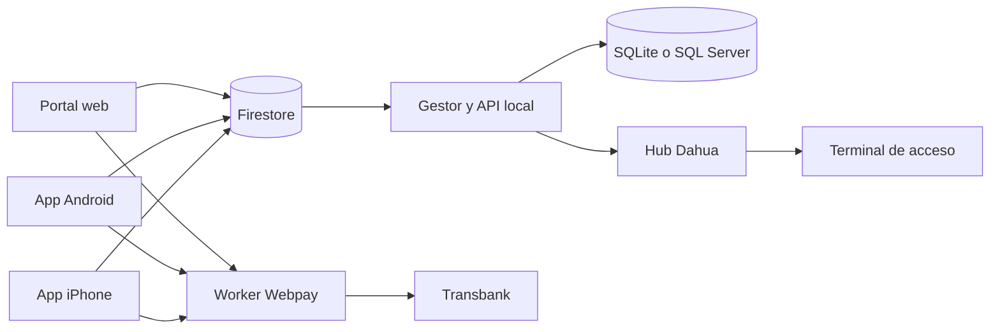

# RestBlu

RestBlu es un prototipo de gestión de alojamientos y acceso para huéspedes. Reúne un portal de reservas, apps nativas para Android y iPhone, un gestor local, un servicio de pagos de integración y un hub para terminales Dahua. El flujo conecta la búsqueda y solicitud de estadía con la verificación de correo, la validación del pago, la emisión del pase y la administración del acceso durante la reserva.

## Componentes

| Carpeta | Función | Tecnología principal |
| --- | --- | --- |
| [`frontend/`](frontend/) | Catálogo, búsqueda, reserva y pase del huésped | React, TypeScript, Vinext, Firebase |
| [`android-app/`](android-app/) | Experiencia nativa del huésped, reservas y acceso | Kotlin, Jetpack Compose |
| [`ios-app/`](ios-app/) | Experiencia nativa para iPhone: reservas, Webpay, QR y acceso | Swift, SwiftUI |
| [`backend/`](backend/) | API y panel local; sincronización, correo, PDF y reglas de negocio | Node.js, SQLite o SQL Server, Firebase Admin |
| [`payments-worker/`](payments-worker/) | Inicio y retorno de transacciones Webpay Plus | Cloudflare Worker |
| [`dahua-hub/`](dahua-hub/) | Registro de terminales y cola de comandos de acceso | Node.js, SQL Server |
| [`documentacion/`](documentacion/) | Diagrama del proceso y mapa de módulos | BPMN, draw.io, Markdown |

## Flujo principal

1. El huésped consulta alojamientos y solicita una reserva desde la web, Android o iPhone. Firebase Firestore recibe las solicitudes del sitio publicado.
2. El gestor local importa las solicitudes, comprueba disponibilidad y guarda los datos en SQLite o SQL Server.
3. El huésped verifica su correo. El pago se inicia en Webpay Plus y el gestor vuelve a consultar a Transbank el estado, monto y orden antes de confirmar.
4. La reserva confirmada habilita el pase con QR y PIN y permite gestionar el acceso asociado a la estadía. Las apps móviles también pueden solicitar apertura mediante una clave del teléfono protegida por biometría.
5. El hub comunica el gestor con terminales Dahua mediante Auto Register y procesa comandos con vigencia limitada a la reserva.



## Ejecutar en desarrollo

Se requiere Node.js 22 o superior. En Windows, los lanzadores de la raíz permiten iniciar la web, el gestor o ambos. Para iniciar cada servicio manualmente:

```powershell
cd frontend
npm ci
npm run dev
```

```powershell
cd backend
npm ci
npm start
```

El portal local utiliza `http://localhost:3000` y el gestor `http://127.0.0.1:3100`. La app Android se abre desde `android-app/` con Android Studio y la app iPhone desde [`ios-app/RestBlu.xcodeproj`](ios-app/RestBlu.xcodeproj/) con Xcode en un Mac. El hub se inicia con `npm ci` y `npm start` en `dahua-hub/`. El Worker se configura desde `payments-worker/wrangler.toml` y requiere Wrangler para su despliegue. Cada componente tiene instrucciones adicionales en su propio README.

La configuración privada del gestor vive fuera del repositorio, en `%LOCALAPPDATA%\RestBlu\.env.local`; hay ejemplos en `backend/.env.local.example`, `frontend/.env.example` y `dahua-hub/.env.example`. Para sincronización y correo se necesitan credenciales propias de Firebase Admin y SMTP. El hub y las funciones de acceso físico necesitan la configuración y el hardware correspondientes.

## Verificación

```powershell
cd frontend; npm run check
cd ../backend; npm test
cd ../dahua-hub; npm test
cd ../payments-worker; node --test src/index.test.js
```

## Alcance de esta publicación

Este repositorio contiene el **código fuente y los diagramas**. No incluye bases de datos con reservas, fotos de huéspedes, respaldos, credenciales, dependencias instaladas, APK compilados ni videos promocionales. La configuración de Webpay está orientada al ambiente de integración; no debe interpretarse como un sistema de cobros de producción. La sincronización en línea y el procesamiento de solicitudes dependen de que el gestor local esté en ejecución.

La documentación técnica detallada está en [`documentacion/ESTRUCTURA_DEL_PROYECTO.md`](documentacion/ESTRUCTURA_DEL_PROYECTO.md).
